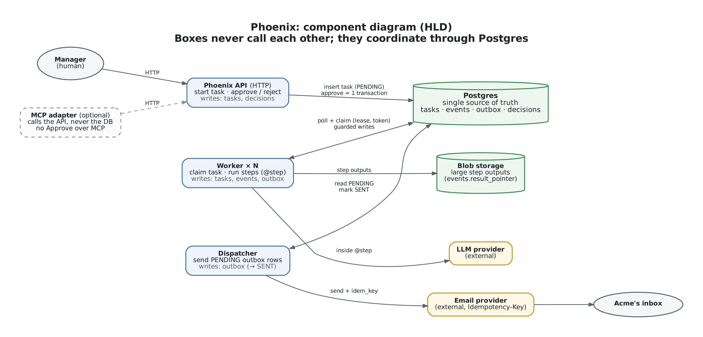

# Phoenix: High-Level Design

**Status:** v1.1, TypeScript core + Python tools server (16 Nov 2026) · **Scope:** single-region, sequential steps within a task
**Companion docs:** `LLD.md` (how each part works), `phoenix_design_notes.md` (decision log),
`Phoenix_Components.png`, `Phoenix_Task_State_Machine.png`

---

## 1. Purpose

Phoenix runs long-lived AI agent tasks (hours of LLM and tool calls, human approvals that can
take days, emails to real people) and keeps them correct when the infrastructure fails.

A user gives Phoenix a **goal**. The LLM turns it into a **plan** of steps chosen from a fixed
**step registry** (web search, fetch page, summarise, calculate, analyse data, allowlisted MCP tools, write report, request approval, send email).
Phoenix runs the plan step by step and finishes it even if workers are killed, frozen, rate-limited
or redeployed at any point.

**The test:** `kill -9` a worker at any moment, restart, and the task still finishes with no
duplicate emails, no re-paid LLM work for finished steps, and the same result.

### Non-goals (v1)
- Fan-out / parallel steps inside one task (later phase)
- Microservices or a message broker (see decision D7)
- Multi-region, database failover, clock-skew handling (Phase 9)
- The model writing and executing arbitrary code (it picks steps from a registry)

---

## 2. Requirements

### 2.1 Functional
| # | Requirement |
|---|---|
| F1 | A person starts a task with a goal through the Phoenix API |
| F2 | The LLM produces a plan from the step registry; the plan is saved before any step runs |
| F3 | Workers execute the plan's steps in order, saving each result |
| F4 | A `request_approval` step pauses the task until a person approves or rejects it |
| F5 | `send_email` steps deliver email to recipients |
| F6 | A person can see a task's status, its steps and their results |
| F7 | Steps can do reliable calculations and data analysis through tools (not LLM arithmetic) |

### 2.2 Promises (testable non-functional requirements)
| # | Promise | Verified by |
|---|---|---|
| P1 | A step whose result is **saved** is never executed again | Kill at random steps N times; zero repeated LLM calls for saved steps |
| P2 | At most one worker owns a task at any time; if the owner dies, another takes over within **~35 s** | Kill and freeze workers; measure takeover time; assert stale writes rejected |
| P3 | Saved results survive any crash; at most **one step** of LLM work is repeated per crash | Kill N times; repeated LLM calls ≤ N |
| P4 | Each side effect is delivered with its chosen guarantee (§6): outreach email at-most-once; must-arrive email exactly-once-effective | Kill between "decided" and "sent"; count deliveries |
| P5 | A permanent failure of one step (e.g. 404) does not fail the task | Inject 404s; task reaches DONE with errors recorded |
| P6 | A task waiting for approval survives any number of restarts and resumes when approved | Restart everything while waiting; approve; task completes |
| P7 | A task never exceeds its step limit or cost budget | Planner proposes 500 steps / loop; task stops at the limit |

---

## 3. Failure model

| Failure | What it threatens | How Phoenix handles it |
|---|---|---|
| Pod OOM-killed / evicted / `kill -9` | Progress, duplicates | Step results saved in `events`; lease expires; another worker claims and **replays from the start**, skipping saved steps |
| Worker frozen (GC pause, network partition) then resumes | Stale writes, double side effects | **Fencing token** + lease checked inside every write; a rejected write makes the worker drop the task |
| Crash between two related writes | Lost email, lost approval | Related writes go in **one transaction** (events + outbox; decision + task status) |
| Crash after calling an external API, before recording it | Duplicate email | **Transactional outbox** + dispatcher sending with an **idempotency key** |
| LLM provider 429 / timeouts / 5xx | Failed steps | Transient → retry with exponential backoff + jitter (Retry-After respected); permanent → record and continue |
| Deploy rotating pods mid-task | Same as a crash | Same as a crash (L5 adds rules for code changes, see §10) |
| Human takes days to approve | Leases held forever, lost state | Task moves to `WAITING_APPROVAL` and **releases its lease**; state lives in Postgres |
| LLM non-determinism on replay | Diverging history | Every unpredictable call happens **inside a step**; replay returns saved results |
| Runaway plan / loops | Cost | Max steps and cost budget per task (P7) |

---

## 4. Architecture

| Component | Responsibility | Writes | Scaling |
|---|---|---|---|
| **Phoenix API** (HTTP) | The only entry point for people: start tasks, view them, approve/reject | `tasks` (insert; PENDING on approve; FAILED on reject), `decisions` | 1+ replicas, stateless |
| **Worker** | Long-running loop: claim a task → replay/run its steps → release → claim the next | `tasks` (claim, renew, pause, done), `events`, `outbox` (creates rows) | N replicas, stateless |
| **Dispatcher** | Send PENDING outbox rows to the outside world, mark them SENT | `outbox` (status, attempts) | 1 replica (safe to scale later with SKIP LOCKED) |
| **Postgres** | Single source of truth; also the work queue | — | Single primary |
| **Blob storage** | Large step outputs (pages, LLM text); `events.result_pointer` points here | written by workers | — |
| **phoenix-tools** (Python, MCP server) | Calculations and analytics (pandas, safe maths, read-only SQL) | nothing; stateless | 1+ replicas |
| *MCP adapter* (optional) | Lets an AI assistant start/view tasks via the API | none directly | — |

External: LLM provider (called by workers, inside steps), email provider (called by the
dispatcher, with idempotency key).

Direct calls are allowed only where the caller needs an answer now and `step()` handles the
failure: worker → LLM provider, worker → phoenix-tools (MCP), worker → other allowlisted MCP servers.
Tools reached this way must be **read-only**; anything that changes the outside world goes
through the outbox.

### Architectural principles
1. **Components never call each other.** They coordinate through durable rows in Postgres.
   A row survives crashes; a call doesn't. Each component fails and scales independently.
2. **Workers are interchangeable.** No task state lives in a worker's memory between steps.
3. **Code decides the flow; the LLM works inside steps.** The LLM chooses *what* (the plan);
   Phoenix guarantees it *survives*.
4. **Every fact lives in one place.** One status column; next step derived from `events`;
   email delivery tracked only in `outbox`.

---

## 5. Data ownership and flows

### 5.1 Who writes what
| Table | API | Worker | Dispatcher |
|---|---|---|---|
| `tasks` | insert; WAITING_APPROVAL → PENDING / FAILED | claim, renew, pause, DONE | — |
| `events` | — | insert (guarded) | — |
| `outbox` | — | insert (guarded, same txn as events) | status → SENT / FAILED |
| `decisions` | insert (same txn as tasks update) | — | — |

### 5.2 Key flows
**Start a task.** API inserts `tasks(status=PENDING, goal)`. A worker finds it on its next poll.

**Run.** Worker claims (lease 30 s, token +1), renews every 10 s, runs the workflow from the
start: step 1 = plan (saved), then each planned step. Finished steps return saved results.

**Send an email (step N).** Inside the step: LLM writes the body → one guarded transaction writes
the `events` row and the `outbox` row (`idem_key = hash(task_id, N)`, PENDING). Later the
dispatcher sends it with the key and marks it SENT.

**Crash and takeover.** Owner dies → lease expires (≤30 s) → another worker's poll (≤5 s)
claims with a new token → replays → continues from the first unsaved step.

**Frozen worker.** Wakes up, attempts a guarded write with its old token → 0 rows → drops the task.

**Approval.** Worker reaches `request_approval` with no decision → sets `WAITING_APPROVAL`,
releases the lease, stops. Manager approves → API writes the decision and sets PENDING in one
transaction → a worker claims and replays → the approval step now finds the decision → continues.
Reject → FAILED (final).

**Completion.** After the last step commits, the worker sets DONE. Pending emails are the
dispatcher's job and don't hold the task open.

Task lifecycle: see `Phoenix_Task_State_Machine.png` and LLD §3.

---

## 6. Delivery guarantees per side effect

| Side effect | Cost of duplicate | Cost of missing | Guarantee | Mechanism |
|---|---|---|---|---|
| Outreach email (provider dedupes keys) | Looks like spam | Lost lead | Exactly-once effective | Outbox + retry until SENT + idem_key |
| Outreach email (provider can't dedupe) | Spam, reputation | Low | At-most-once | Record before send |
| Must-arrive email (password, alerts) | Harmless | User blocked | At-least-once | Outbox + retry until SENT |
| LLM call | Cost only | Step can't finish | At-least-once, saved once | Inside `@step` |

Rule: for each side effect, compare the cost of a duplicate with the cost of a missing one,
and avoid the more expensive failure.

---

## 7. Capacity and back-pressure (v1 numbers)

| Parameter | Value | Reason |
|---|---|---|
| Lease duration | 30 s | Tolerates 2 missed heartbeats |
| Heartbeat | every 10 s | |
| Worker poll | 5 s ± 1 s jitter | Worst-case takeover ≈ lease + poll ≈ 35 s (P2) |
| Step retries (transient) | 5 attempts, backoff 1 s → 30 s cap, full jitter | Honour `Retry-After` |
| Max steps per task | 200 (configurable) | P7 |
| Cost budget per task | configurable (tokens) | P7 |

Load is small: 3 workers polling every 5 s ≈ 36 indexed queries/min.
**Shared provider limit (H5, decided 22 Nov 2026):** the LLM provider's limit is per API key,
so workers share one **cool-down** in Postgres. Any 429 or 5xx pushes it forward (Retry-After,
else backoff), and every LLM call waits it out first, so all workers back off together. A 429
does not use up one of a step's attempts (the provider did no work); a step gives up only after
`OVERLOAD_MAX_WAIT_MS` (15 min) of overload. Cost: per-task token budget and max steps (P7);
no global cap. Details: LLD §4.3.

---

## 8. Deployment

One TypeScript codebase with three entry points in one Node image (a modular monolith, not
microservices), plus a separate stateless Python tools server:

| Service | Command | Ports | Replicas |
|---|---|---|---|
| postgres | `postgres:16` | 5432 | 1 |
| migrate | `node dist/src/migrate.js` (one-shot; others start after it exits 0) | none | 1 |
| api | `node dist/src/api.js` | 8000 | 1 |
| worker | `node dist/src/worker.js` | none | 3 |
| dispatcher | `node dist/src/dispatcher.js` | none | 1 |
| phoenix-tools | `python server.py` (MCP, Streamable HTTP) | 8100 (internal) | 1 |
| fake-llm / fake-email (dev & chaos tests) | `node dist/testing/fake-llm.js` / `fake-email.js` | 9001 / 9002 | 1 |

---

## 9. Key decisions

| # | Decision | Alternatives rejected | Why |
|---|---|---|---|
| D1 | Event log + replay from the start | Jump to first missing step | Replay rebuilds in-memory state; workflow stays ordinary code |
| D2 | Leases + monotonic fencing token | Owner check only | Catches name reuse after pod restarts; usable by external systems |
| D3 | Transactional outbox + dispatcher | Send from the step | Check-then-act gap; crash between send and record |
| D4 | Idempotency key = hash(task_id, step_id) | uuid4, timestamp, pod id, task id | Must be identical on every retry of one step, different across steps |
| D5 | Single `status` column | status + approval_status + completed flag | Columns contradict each other |
| D6 | DONE when the last step commits | DONE when all emails SENT | Workers would idle on delivery outages; delivery is the dispatcher's concern |
| D7 | Postgres as the queue | RabbitMQ / Kafka | Dual-write problem; task state lives in DB anyway; tiny load |
| D8 | Modular monolith (shared DB) | Microservices | Cross-table transactions; one person, one deploy |
| D9 | LLM plans from a step registry; plan is step 1 | LLM generates code | Safety; side effects stay in the outbox; replay gets the same plan |
| D10 | No STARTED rows in `events` | Row at step start | Replay complexity; visibility from logs |
| D11 | Sequential steps in v1 | Fan-out | Fan-in races and shared limits; add later |
| D12 | TypeScript core; Python MCP server for calculations/analytics | All Python; all TypeScript | Fluency for the core; pandas/numpy for analysis; MCP is language-neutral |
| D13 | Tools via registry steps; MCP tools allowlisted and read-only | LLM calls any MCP tool directly | Results saved and replayable; side effects stay in the outbox |

---

## 10. Open items

| Item | Needed before |
|---|---|
| ~~H5: shared LLM rate limiter across workers; retry budgets; behaviour under sustained overload~~ | Decided 22 Nov 2026 (capacity table note above, LLD §4.3) |
| L5: changing workflow code while tasks are in flight (version pinning per task) | Redeploying during long runs |
| L5: observability (structured logs per task/step, traces across takeovers, alerts for stuck tasks and stuck outbox rows) | Phase 8 |
| Plan validation rules (allowed step types, argument schemas) | Phase 7 |

---

## 11. Verification

Each build phase ends with a chaos test (see `RESUME.md`): random `kill -9`, `kill -STOP` /
`kill -CONT` to freeze workers, injected 429s and timeouts, restarts while waiting for approval.
The headline metric is **cost of recovery**: re-spent tokens, duplicate emails and minutes lost
per crash, compared with a naive retry-from-scratch agent.
